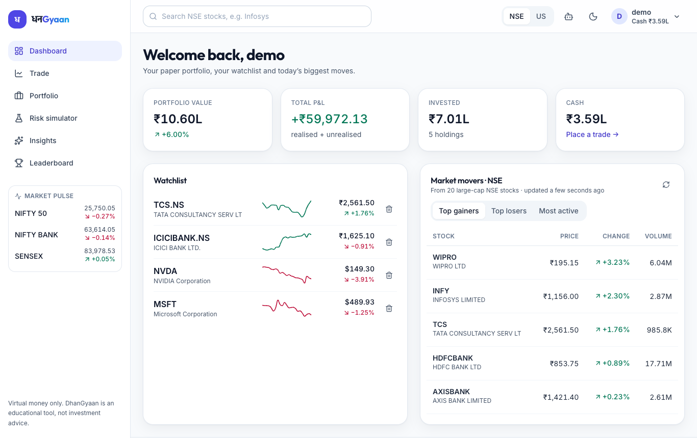
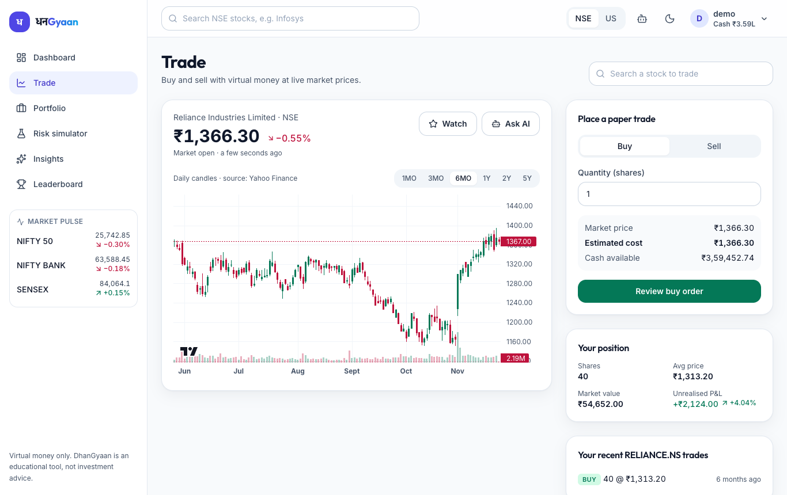
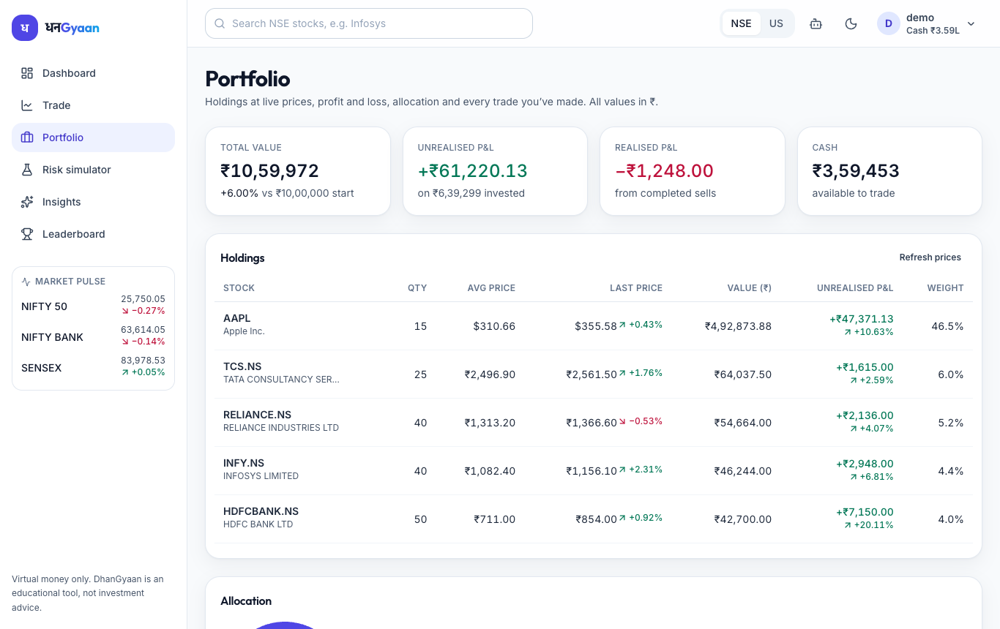
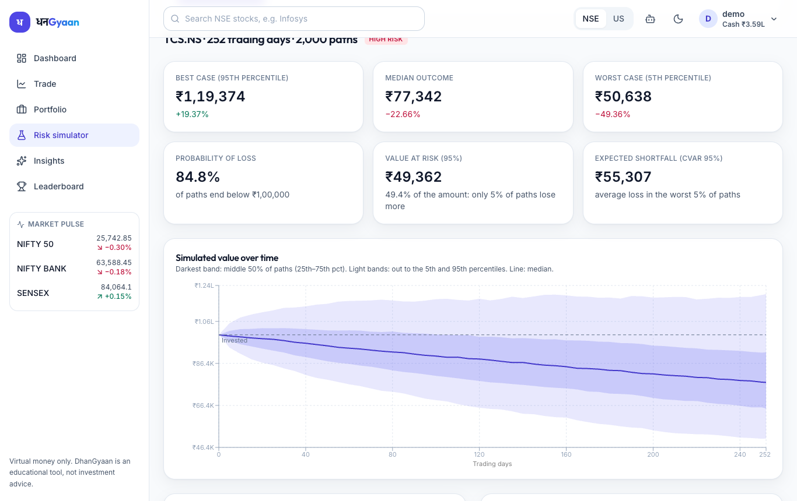
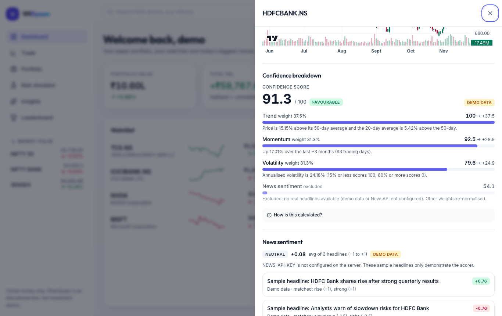
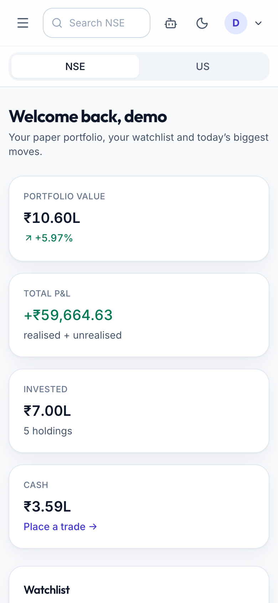
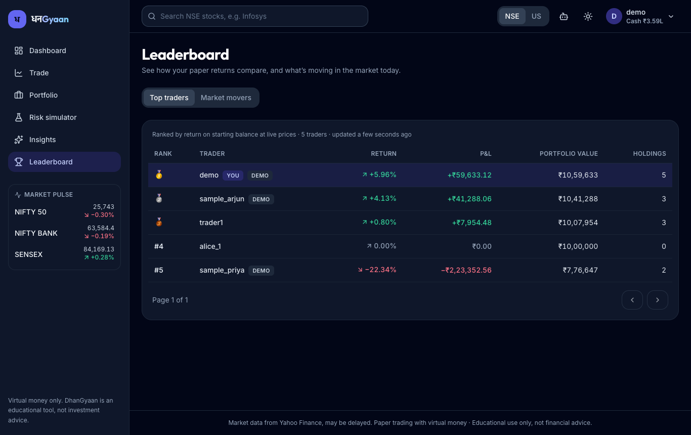
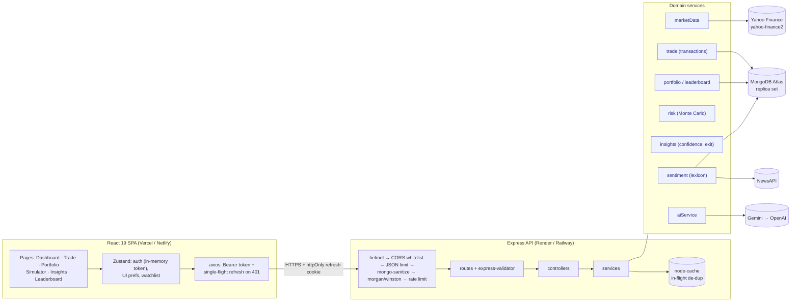

# धनGyaan (DhanGyaan): Investment risk evaluator & paper-trading platform

> Understand the risk **before** you invest. Practise with virtual money on real NSE and US prices, stress-test any
> stock with a Monte Carlo simulator, and see a confidence score whose every input is explained.

**Finvasia hackathon finalist** · React 19 · Node/Express · MongoDB · yahoo-finance2 · Gemini/OpenAI



> ⚠️ **Educational project. Not financial advice.** DhanGyaan uses virtual money only. Market data comes from Yahoo
> Finance and may be delayed.

---

## Contents
- [The problem](#the-problem)
- [Features](#features)
- [Architecture](#architecture)
- [How the numbers are computed](#how-the-numbers-are-computed)
- [Tech stack](#tech-stack)
- [Run it locally](#run-it-locally)
- [Environment variables](#environment-variables)
- [API reference](#api-reference)
- [Testing & quality](#testing--quality)
- [Deployment](#deployment)
- [Hackathon context](#hackathon-context)

## The problem

First-time retail investors in India are shown a single “safe/risky” label, a hot tip, or a wall of news, with no way to
see *why* a stock is risky or to practise without losing money. DhanGyaan combines three things in one place:

1. **A safe place to practise:** paper trading at live prices with a realistic ledger.
2. **A way to see risk as a range:** simulated outcomes with probability of loss and Value at Risk.
3. **Transparent signals:** a confidence score and news sentiment where every number shows its inputs.

A core rule of the project: **no fake data presented as real.** Every number is either live market data or a
computation you can inspect. When a source isn't available (e.g. no NewsAPI key), the UI says so with a
**“Demo data”** badge, and demo data is never mixed into real scores.

## Features

| | |
|---|---|
| **Paper trading:** start with ₹10,00,000; buy/sell NSE (`.NS`) and US stocks at the live price, fetched server-side. US trades settle in ₹ at the live USD/INR rate. Every order is a MongoDB transaction. |  |
| **Portfolio:** holdings at live prices, weighted-average cost, realised & unrealised P&L, % return, allocation chart, trade history with filters and pagination, and an AI “explain my portfolio”. |  |
| **Monte Carlo risk simulator:** geometric Brownian motion calibrated on the stock's real daily log returns. Best/median/worst case, P(loss), VaR 95%, CVaR 95%, fan chart, calibration stats and assumptions. Seeded, so results are reproducible. |  |
| **Confidence score & sentiment:** trend, momentum, volatility and news sentiment with published weights; each component shows its raw metric, score and contribution. Headlines are scored by a deterministic lexicon that lists the words it matched. |  |
| **AI tutor:** ask questions in plain English. The model receives the live quote, the confidence breakdown and *your* position, and is told never to invent numbers. Gemini first, OpenAI fallback, a labelled rule-based answer if neither key is set. | **Also:** watchlist with live prices & real sparklines · leaderboard ranked by % return · market movers and index pulse for NSE/US · exit coach (volatility-based stops) · SIP calculator · historical stress test · dark mode |

<p align="center"> &nbsp; </p>

## Architecture



**Backend layering:** `routes` (validation only) → `controllers` (HTTP in/out) → `services` (all business logic,
unit-testable) → `models` (Mongoose). Every response uses the same envelope: `{ success, data, message }`.

**Auth:** a 15-minute access JWT is kept **in memory** on the client (not localStorage). A 7-day refresh JWT lives in an
**httpOnly cookie** scoped to `/api/auth`. On a page reload the app calls `/auth/refresh` to restore the session.
Logout increments `user.tokenVersion`, which revokes every refresh token issued before it.

**Paper-trade consistency:** see [the trade engine](#paper-trade-engine) below.

## How the numbers are computed

### Monte Carlo risk engine
`server/services/risk.service.js`

1. **Calibrate on real data.** Take 1–2 years of daily closes and compute log returns `rₜ = ln(Pₜ / Pₜ₋₁)`.
   Estimate `m = mean(r)` and `s = stdev(r)`.
2. **Simulate.** Under geometric Brownian motion each day's log return is normal, so for every path

   ```
   Vₜ₊₁ = Vₜ · exp(m + s·Z),   Z ~ N(0, 1)
   ```

   (This is GBM with drift `μ = m + s²/2`. Using `m` directly already includes the volatility drag, so it isn't
   subtracted twice.) `Z` comes from a seeded mulberry32 PRNG plus a Box–Muller transform, so a run is reproducible from its seed.
3. **Summarise the N final values:**
   - best / median / worst = 95th / 50th / 5th percentile (percentiles, not max/min, because extremes are noise)
   - **P(loss)** = share of paths ending below the amount invested
   - **VaR 95%** = amount − 5th percentile (only 5% of paths lose more)
   - **CVaR 95%** = average loss within that worst 5%
   - fan chart = 5/25/50/75/95th percentiles at ~60 checkpoints

The test suite checks the engine against the closed-form GBM answers: median `= A·e^(mT)` and
`P(loss) = Φ(−m√T / s)`. **Assumptions** (shown in the UI): normal i.i.d. log returns, constant volatility (fat tails
are understated), no fees/dividends/FX, and the past is not a forecast.

### Confidence score (0–100)
`server/services/insights.service.js`

| Component | Weight | Input | Mapping to 0–100 |
|---|---|---|---|
| Trend | 30% | price vs 50-day SMA, and 20-day vs 50-day SMA | `50 + 50·clamp(Δ/10%)` and `50 + 50·clamp(Δ/5%)`, averaged |
| Momentum | 25% | return over the last 63 trading days (~3 months) | `50 + 50·clamp(r/20%)` |
| Volatility | 25% | annualised σ of daily log returns (`σ_daily·√252`) | 15% → 100, 60% → 0, linear between |
| Sentiment | 20% | average headline score (−1…+1) | `50 + 50·score` |

`score = Σ(weightᵢ × componentᵢ) / Σ(weights used)`. If sentiment is demo data, it is **excluded** and the remaining
weights are re-normalised, so sample headlines can never move a real score. Labels: ≥65 Favourable, 40–65 Mixed, <40 Weak.
It measures how supportive recent data is. It is **not** a buy/sell signal.

### News sentiment
`server/services/sentimentScorer.js`: headlines are tokenised into whole words (so “up” doesn't match
“update”). Each lexicon term adds its weight, a negator in the two words before flips the sign (“fails to beat” is
negative), and the sum is squashed with `tanh` into (−1, 1). The UI lists the matched words for every headline. Results
are cached in MongoDB (`SentimentCache`, TTL index) for 30 minutes to respect NewsAPI's free-tier quota.

### Paper-trade engine
`server/services/trade.service.js`

- The client sends only `{ symbol, side, quantity }`. **The price and FX rate are fetched on the server**; a price in
  the request body is ignored.
- Validation: quantity must be a positive whole number; unknown symbols → 404; insufficient cash and overselling → 400.
- **Consistency:** cash, holding and trade record are written inside one MongoDB **transaction**, so they commit together
  or not at all. The cash debit is a **conditional atomic update** (`{ balance: { $gte: cost } }` + `$inc`), so
  concurrent orders can't spend the same rupee twice. If two transactions touch the same portfolio, MongoDB raises a
  write conflict and the transaction is retried with fresh data.
- **P&L:** weighted-average cost per share in ₹ (including FX for US stocks). A sell realises
  `(sell price₹ − avg cost) × qty`; the average cost is unchanged by sells. Portfolio total value = cash + holdings at
  live prices, and **total value − starting balance = realised + unrealised P&L** (asserted in tests).

## Tech stack

| Layer | Technology |
|---|---|
| Frontend | React 19, Vite, Tailwind CSS (dark mode), Zustand, React Router 7, Recharts, lightweight-charts, react-hook-form + zod, axios, dayjs, react-hot-toast, lucide-react |
| Backend | Node.js 22+, Express 4 (ES modules), Mongoose 8, JWT + bcryptjs, express-validator, helmet, express-rate-limit, express-mongo-sanitize, morgan + winston, node-cache |
| Data | MongoDB (replica set: Atlas, or `npm run dev:db` locally), yahoo-finance2 v4, NewsAPI |
| AI | Google Gemini (`@google/generative-ai`), OpenAI (fallback) |
| Quality | Jest + Supertest + mongodb-memory-server, ESLint, GitHub Actions |

## Run it locally

**Prerequisites:** Node.js **22+** and either a MongoDB Atlas URI or nothing at all (a local replica set script is included).

```bash
git clone https://github.com/AnngadKhuranaa/DhanGyaan_Scam2026.git
cd DhanGyaan_Scam2026

# 1. API
cd server
npm install
cp .env.example .env            # set JWT_SECRET and JWT_REFRESH_SECRET (two different random strings)
npm run dev:db                  # terminal A: local MongoDB replica set (skip if MONGO_URI points to Atlas)
npm run seed                    # optional: demo account with real historical trades
npm run dev                     # terminal B: http://localhost:5000  (check /api/health)

# 2. Web app
cd ../client
npm install
cp .env.example .env            # VITE_API_BASE_URL=http://localhost:5000/api
npm run dev                     # http://localhost:5173, then click "Try the demo"
```

> Generate secrets with `openssl rand -hex 32`. Transactions need a replica set: a plain standalone `mongod` will
> reject trades, so use Atlas or `npm run dev:db`.

## Environment variables

**server/.env**

| Variable | Required | Default | Purpose |
|---|---|---|---|
| `MONGO_URI` | ✅ | – | MongoDB connection string (must be a replica set) |
| `JWT_SECRET` | ✅ | – | Signs 15-min access tokens |
| `JWT_REFRESH_SECRET` | ✅ | – | Signs 7-day refresh tokens (must differ from `JWT_SECRET`) |
| `CLIENT_URL` | | `http://localhost:5173` | Comma-separated CORS whitelist (also governs cookies) |
| `PORT` | | `5000` | HTTP port |
| `NODE_ENV` | | `development` | `production` enables `Secure; SameSite=None` cookies |
| `NEWS_API_KEY` | | – | NewsAPI key; without it sentiment shows labelled demo headlines |
| `GEMINI_API_KEY` / `GEMINI_MODEL` | | – / `gemini-2.5-flash` | Primary AI provider |
| `OPENAI_API_KEY` / `OPENAI_MODEL` | | – / `gpt-4o-mini` | Fallback AI provider |
| `STARTING_BALANCE` | | `1000000` | Virtual cash for new users (₹) |
| `ACCESS_TOKEN_TTL` / `REFRESH_TOKEN_TTL_DAYS` | | `15m` / `7` | Token lifetimes |
| `DEMO_USERNAME` | | `demo` | Account used by “Try the demo” |

The server validates required variables at startup and exits with a readable message if any are missing.

**client/.env:** `VITE_API_BASE_URL` (e.g. `https://dhangyaan-api.onrender.com/api`).

## API reference

All responses: `{ success: boolean, data: any, message: string }`. 🔒 = requires `Authorization: Bearer <accessToken>`.

| Method | Endpoint | Description |
|---|---|---|
| GET | `/api/health` | Liveness + database status |
| POST | `/api/auth/register` | `{ username, email, password, phone? }` → user + access token, sets refresh cookie |
| POST | `/api/auth/login` | `{ identifier, password }` (username or email) |
| POST | `/api/auth/demo` | Log into the shared demo account |
| POST | `/api/auth/refresh` | New access token from the refresh cookie |
| POST | `/api/auth/logout` | Clears cookie, revokes refresh tokens |
| GET | `/api/auth/me` 🔒 | Current user |
| GET | `/api/market/quote/:symbol` | Live quote |
| GET | `/api/market/quotes?symbols=A,B` | Batch quotes (≤25) |
| GET | `/api/market/history/:symbol?range=` | Daily candles (`1mo 3mo 6mo 1y 2y 5y`) |
| GET | `/api/market/search?q=&market=IN\|US` | Ticker search |
| GET | `/api/market/movers?market=` | Gainers / losers / most active (20 large caps) |
| GET | `/api/market/indices?market=` | NIFTY 50 / BANK / SENSEX or S&P 500 / NASDAQ / Dow |
| POST | `/api/trades` 🔒 | `{ symbol, side: BUY\|SELL, quantity }`, executed at the live price |
| GET | `/api/trades` 🔒 | History: `page, limit, symbol, side, from, to` |
| GET | `/api/portfolio` 🔒 | Holdings, P&L, allocation, return |
| POST | `/api/risk/simulate` 🔒 | `{ symbol, amount, horizonDays?, paths?, lookback?, seed? }` |
| GET | `/api/insights/confidence/:symbol` 🔒 | Confidence score with breakdown |
| GET | `/api/insights/sentiment/:symbol` 🔒 | Scored headlines |
| GET | `/api/insights/exit/:symbol?entry=` 🔒 | Volatility stop, targets, support/resistance |
| POST | `/api/ai/chat` 🔒 | `{ message, symbol?, history? }` |
| POST | `/api/ai/explain-portfolio` 🔒 | Plain-language portfolio explanation |
| GET | `/api/leaderboard?page=&limit=` 🔒 | Traders ranked by % return |
| GET/POST | `/api/watchlist` 🔒 | List with live quotes / add `{ symbol }` |
| DELETE | `/api/watchlist/:symbol` 🔒 | Remove |

Rate limits: 1000 requests / 15 min per IP overall, 20 failed auth attempts / 15 min, 10 AI requests / min.

## Testing & quality

```bash
cd server && npm test     # 57 tests, Jest + Supertest on a real in-memory MongoDB replica set
cd server && npm run lint
cd client && npm run lint && npm run build
```

External APIs are replaced with deterministic fakes, so tests never touch the network. Highlights:
- **Trading rules:** insufficient funds, overselling, quantity ≤ 0 / fractional, unknown symbol, client price ignored, FX settlement.
- **Concurrency:** 6 simultaneous buys where cash covers 3 → exactly 3 succeed; parallel sells can't sell the same shares twice; a forced failure mid-transaction rolls back every write.
- **P&L:** weighted average cost, realised/unrealised P&L and the totals identity.
- **Risk engine:** seed reproducibility, percentile ordering, agreement with closed-form GBM.
- **Auth:** token refresh, revocation on logout, NoSQL-injection attempt, validation errors.

CI (`.github/workflows/ci.yml`) runs lint, tests and the client build on every push and pull request.

## Deployment

| Piece | Where | How |
|---|---|---|
| Database | **MongoDB Atlas** (free M0) | Create a cluster, a database user, and allow access from your host. Copy the `mongodb+srv://…` URI. |
| API | **Render** (or Railway) | *New → Blueprint* → select this repo; `render.yaml` builds `server/`, health-checks `/api/health` and generates both JWT secrets. Set `MONGO_URI`, `CLIENT_URL` (your frontend URL) and any API keys. On Railway: root `server`, start `npm start`, same variables. |
| Web app | **Vercel** (or Netlify) | Import the repo with root directory `client`; `vercel.json` adds the SPA rewrite. Set `VITE_API_BASE_URL=https://<api-host>/api`. For Netlify, `netlify.toml` at the repo root is already configured. |
| Demo data | once | Run `npm run seed` locally with `MONGO_URI` pointing at Atlas. |

Production notes: set `NODE_ENV=production` (already in `render.yaml`) so the refresh cookie is `Secure; SameSite=None`,
which is required because the frontend and API are on different sites. `CLIENT_URL` must exactly match the frontend
origin. The free Render tier sleeps when idle, so the first request after a while is slow. NewsAPI's free plan is
intended for development; without a key the app still works and labels sentiment as demo data.

## Hackathon context

DhanGyaan began as a team submission to the **Finvasia hackathon**, where it reached the **finals**. The hackathon build
proved the idea but relied on placeholders: mock market data, random confidence scores, a client-trusted trade flow and
unrouted pages. This version keeps the original stack and vision and rebuilds the internals so that every feature
genuinely works:
real market data, transactional trades, a calibrated risk model, transparent scoring, tests and a deployable setup.

## Author

**Anngad Khuranaa**, CSE (AI/ML) student.

Built for learning. Nothing here is investment advice.
